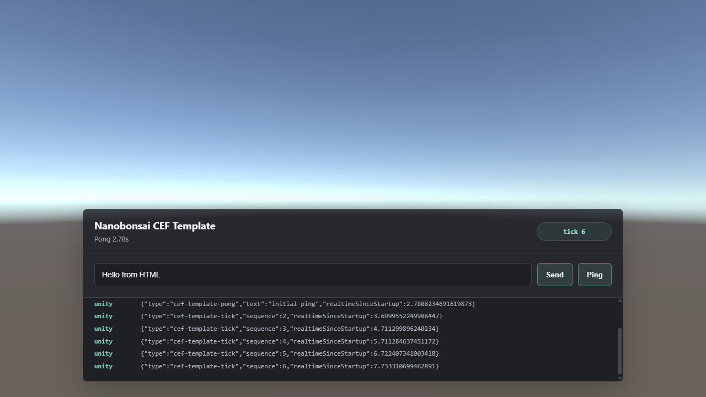

# nanobonsai

**HTML, CSS and JavaScript interfaces for Unity, rendered by Chromium.**

[](LICENSE)




nanobonsai embeds the [Chromium Embedded Framework](https://bitbucket.org/chromiumembedded/cef) (CEF) in Unity 6. It renders HTML pages offscreen and draws them into a uGUI `RawImage`, with pointer, wheel and keyboard input forwarded and JSON messages both ways between the page and C#. You can build menus, HUDs and tools with the web stack and lay them over the game, with transparency.

## Features

- **Chromium 148 in Unity 6**: Windows x64 in the Editor and in players; Apple Silicon macOS players (experimental).
- **GPU frame hand-off under Direct3D 12.** Chromium's shared texture is copied into the view's texture on Unity's render thread, so frames never cross the CPU. Under Direct3D 11 frames are copied straight into the texture's memory, and a failed hand-off falls back to that path on its own.
- **Smooth motion.** Pages paint up to 120-144 times a second (the display's refresh, kept within that range) instead of CEF's default 30.
- **Transparent pages** over the game, sized to the screen or to any `RectTransform`, DPI-correct through the canvas scale.
- **Two-way JSON messaging**: `UnityBridge.send` / `sendToUnity` in the page, `OnMessage` / `SendToJavaScript` in C#.
- **World-click blocking**: the page reports when the pointer is over its UI, so clicks on transparent areas can reach the game.
- **Side-by-side instances.** Each process gets its own CEF cache folder, so several game instances (for example local multiplayer testing) can run at once. Folders of ended processes are cleaned up at the next start.
- **Ready for players.** A build step copies the CEF runtime, its license files and the bridge's notices into Windows players (and, experimentally, Mac players).
- **Small, readable bridge**: one C# component and one C++ file. Prebuilt Windows binaries are included, built with MinGW-w64; the CMake project also has the standard Visual Studio path, not yet tested.

## Requirements

- Unity 6000.4 (developed and tested with 6000.4.7f1)
- Windows 10 or 11 x64 for the Editor and Windows players
- For Mac players: an Apple Silicon Mac to build the macOS payload, macOS 12 or newer to run it
- The Input System package (`com.unity.inputsystem`); the legacy Input Manager also works

## Quick start

1. **Clone** the repository.
2. **Fetch the CEF runtime** from the repository folder, before opening the project in Unity. This downloads the pinned CEF 148 build (about 160 MB, SHA-1 checked) from CEF's official builds and copies the runtime into `Assets/Plugins/x86_64`:
   ```powershell
   powershell -ExecutionPolicy Bypass -File NativePlugin\fetch-cef-windows.ps1
   ```
3. **Open the project**: add the folder in Unity Hub and open it with Unity 6000.4.
4. Choose **CEF > Create Nanobonsai Sample Scene**, then press **Play**. The sample page shows Unity's platform and version, a heartbeat from C#, and Send and Ping buttons that round-trip through `CefTemplateBridge`.

## Using it

### Scene setup

Put a `RawImage` with an `HtmlUiView` under a `Canvas` that has a `GraphicRaycaster`, and keep an `EventSystem` in the scene. Then load a page from `StreamingAssets`:

```csharp
var view = GetComponent<HtmlUiView>();
view.OnMessage += json => Debug.Log("From the page: " + json);
view.LoadStreamingAsset("ui/index.html");
```

With `matchScreenSize` on, the view stretches over its canvas and renders at the screen's resolution. With it off, the browser takes the `RectTransform`'s size times the canvas scale and follows it when it changes.

### The page side

Include `global.js`, which defines the bridge:

```html
<script src="global.js"></script>
<script>
  UnityBridge.onMessage(message => console.log('From Unity:', message));
  sendToUnity('menu-open', { screen: 'settings' });   // C# receives {"type":"menu-open","screen":"settings"}
</script>
```

| Direction | In the page (JavaScript) | In Unity (C#) |
| --- | --- | --- |
| Page → Unity | `sendToUnity(type, payload)` or `UnityBridge.send(object)` | the `HtmlUiView.OnMessage` event receives the JSON string, on Unity's main thread |
| Unity → Page | `UnityBridge.onMessage(callback)` receives the parsed object | `HtmlUiView.SendToJavaScript(json)` |

`CefTemplateBridge` is a small example of routing messages by `type` with `JsonUtility`.

### Letting clicks through to the game

Pages are transparent, so only the page knows where its UI is. Nothing is sent automatically: send `html-pointer-block` when the pointer enters or leaves your panels, and check `HtmlUiView.IsWorldPointerBlocked` before handling world clicks:

```js
panel.addEventListener('mouseenter', () => sendToUnity('html-pointer-block', { blocking: true }));
panel.addEventListener('mouseleave', () => sendToUnity('html-pointer-block', { blocking: false }));
```

### Input

Pointer, buttons and wheel come through uGUI's event system. While the pointer is over the view, typed text goes to the page, as do Backspace, Enter, Delete, Tab, the arrows, Escape, Shift and Backslash, with Shift, Ctrl and Alt as modifiers.

## Player builds

`Assets/Editor/CefPlayerPayload.cs` runs after every build:

- **Windows**: copies what Unity does not ship from `Assets/Plugins/x86_64` (the helper, CEF's resources and locales, `LICENSE.txt`, `CREDITS.html`, `UnityCefPlugin.NOTICES.txt`) into `<Game>_Data/Plugins/x86_64`. It also marks the helper a windowed program, so CEF's child processes open no consoles.
- **macOS**: run `bash NativePlugin/build-cef-mac.sh` on an Apple Silicon Mac first. The build then places the bridge bundle, the framework, the helper apps and the license files inside the `.app`. Sign the app before running it (see [NativePlugin/README.md](NativePlugin/README.md)).

## How it works

```
 page (HTML/JS)                    UnityCefPlugin (C++)                      HtmlUiView (C#)
 console.log("unity:" + json) ──▶  OnConsoleMessage ──▶ callback  ──────▶  OnMessage (main thread)
 UnityBridge._receive(json)  ◀──   ExecuteJS          ◀────────────────── SendToJavaScript
 Chromium paints a frame     ──▶   D3D12: shared texture → bridge's frame ──▶ render thread copies into the texture
                                   otherwise: CPU buffer             ──▶  copied into the texture's memory
```

CEF runs in its own processes (`UnityCefHelper`) and, on Windows, on its own UI thread. On macOS it runs on Unity's main thread, pumped once per frame. [NativePlugin/README.md](NativePlugin/README.md) covers the bridge and how to rebuild it.

## Troubleshooting

- **`Failed to load libcef.dll` or `CEF initialization failed`**: the CEF runtime is missing. Close Unity, run `NativePlugin\fetch-cef-windows.ps1`, and open the project again.
- **The view stays empty**: the path given to `LoadStreamingAsset` is relative to `Assets/StreamingAssets` (for example `ui/index.html`). CEF writes its own log to `%TEMP%\UnityCef\<pid>.log`.
- **Clicks or typing do not reach the page**: the canvas needs a `GraphicRaycaster` and the scene an `EventSystem`. Keys go to the page only while the pointer is over the view.
- **A player opens without UI**: build it from the Editor so `CefPlayerPayload` runs, and keep the files it adds to `<Game>_Data/Plugins/x86_64` together when you ship.

## Limitations

- **Platforms**: Windows x64 and Apple Silicon macOS players only. There is no CEF in the Mac Editor, and no Linux, mobile, console or WebGL support.
- **Video codecs**: CEF's published builds have no proprietary codecs, so H.264/AAC (MP4) video does not play in pages. WebM, VP8/VP9, AV1 and Opus do.
- **The Editor keeps CEF running** from the first Play Mode until it quits, because CEF cannot start twice in one process. CEF's cache folders in `%TEMP%\UnityCef` belong to their process; the next start of the Editor or a player removes those of processes that have ended.
- **No IME composition** (for example Chinese or Japanese input); typed characters arrive one by one.
- **Pages load from `StreamingAssets`** through `file://`.

## License

nanobonsai is released under the [MIT License](LICENSE). Two parts carry their own licenses:

- `NativePlugin/unity/` holds Unity's native plugin API headers, under the Unity Companion License.
- The CEF runtime is not part of this repository. `fetch-cef-windows.ps1` downloads it, under CEF's BSD license, with Chromium's components credited in its `CREDITS.html`.

The prebuilt bridge binaries contain CEF's C++ wrapper and, built with MinGW-w64, its statically linked runtime. Their notices are in `Assets/Plugins/x86_64/UnityCefPlugin.NOTICES.txt`. [THIRD_PARTY_NOTICES.md](THIRD_PARTY_NOTICES.md) lists every component, and the player build ships the required files with your game.
